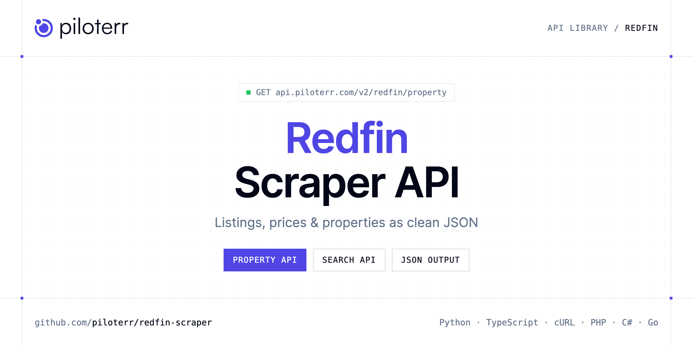

<p align="center">
  <a href="https://www.piloterr.com"></a>
</p>

# Redfin Scraper API

[](https://discord.gg/CFj3ph8aHU) [](https://app.piloterr.com) [](https://app.piloterr.com/openapi) [](LICENSE)

The **Piloterr Redfin Scraper API** lets you extract public data from Redfin as **clean, structured JSON** — no proxies, headless browsers or HTML parsing to maintain. Endpoints available in production:

- **Redfin Property API** — Read one for-sale Redfin home.
- **Redfin Search API** — Search for-sale homes on Redfin from a city, neighborhood, or county link.

Use it for property price monitoring, market analytics, investment sourcing or rental yield models.

| Endpoint | Path | Credits | What you get |
|---|---|---|---|
| [Redfin Property API](#redfin-property-api) | `/v2/redfin/property` | 1 | Read one for-sale Redfin home. Pass the url from search, which already includes the market id. The response is a flat listing, the same fields as one search result. |
| [Redfin Search API](#redfin-search-api) | `/v2/redfin/search` | 1 | Search for-sale homes on Redfin from a city, neighborhood, or county link. Each listing url includes the market id to pass to the property endpoint. |

## Table of contents

- [How it works](#how-it-works)
- [Redfin Property API](#redfin-property-api)
- [Redfin Search API](#redfin-search-api)
- [Code examples in other languages](#code-examples-in-other-languages)
- [Practical use cases](#practical-use-cases)
- [Why Piloterr?](#why-piloterr)
- [FAQ](#faq)
- [Official SDKs](#official-sdks)
- [Related scrapers](#related-scrapers)
- [Support](#support)

## How it works

1. **Create a free Piloterr account** and copy your API key from the [dashboard](https://app.piloterr.com).
2. **Send a `GET` (or `POST`) request** to `https://api.piloterr.com/v2/...` with the header `x-api-key: YOUR_API_KEY`.
3. **Receive structured JSON** — Piloterr handles rendering, proxies, retries and parsing.

```bash
export PILOTERR_API_KEY="your-api-key"
pip install requests        # Python
# TypeScript: Node.js 18+ (native fetch), run with `npx tsx file.ts`
```

> Every endpoint accepts both `GET` (query string) and `POST` (JSON body with the same fields).

## Redfin Property API

Read one for-sale Redfin home. Pass the url from search, which already includes the market id. The response is a flat listing, the same fields as one search result.

`GET | POST https://api.piloterr.com/v2/redfin/property` · **1 credit per request** · [Full reference](https://app.piloterr.com/openapi)

### Request parameters

| Parameter | Type | Required | Description |
|---|---|---|---|
| `query` | string | ✅ | Redfin home link. Use the url returned by search. |
| `region_id` | number | — | Market id. Required only when the home link does not already include region_id. |
| `region_type` | number | — | Required with region_id when the home link has no region_type. |
| `return_page_source` | boolean | — | Optional. Default false. |

### Python example

```python
import json
import os
import requests

response = requests.get(
    "https://api.piloterr.com/v2/redfin/property",
    headers={"x-api-key": os.environ["PILOTERR_API_KEY"]},
    params={
        "query": "https://www.redfin.com/WA/Seattle/1120-8th-Ave-98101/unit-1603/home/14602?region_id=16163&region_type=6",
    },
    timeout=120,
)
response.raise_for_status()
data = response.json()

print(json.dumps(data, indent=2, ensure_ascii=False)[:2000])
```

### TypeScript example

```typescript
type RedfinProperty = {
  hoa?: number;
  url?: string;
  zip?: string;
  beds?: number;
  city?: string;
  sqft?: number;
  unit?: string;
  baths?: number;
  price?: number;
  state?: string;
  mls_id?: string;
  status?: string;
  street?: string;
  remarks?: string;
  latitude?: number;
  lot_size?: unknown;
  is_redfin?: boolean;
  key_facts?: string[];
  longitude?: number;
  agent_name?: string;
  listing_id?: number;
  open_house?: unknown;
  year_built?: number;
  broker_name?: string;
  has_3d_tour?: boolean;
  [key: string]: unknown;
};

const params = new URLSearchParams({
  "query": "https://www.redfin.com/WA/Seattle/1120-8th-Ave-98101/unit-1603/home/14602?region_id=16163&region_type=6",
});

const response = await fetch(`https://api.piloterr.com/v2/redfin/property?${params}`, {
  headers: { "x-api-key": process.env.PILOTERR_API_KEY! },
});
if (!response.ok) throw new Error(`Piloterr error ${response.status}: ${await response.text()}`);

const data = (await response.json()) as RedfinProperty;

console.log(JSON.stringify(data, null, 2).slice(0, 2000));
```

<details>
<summary><b>POST variant</b></summary>

```http
POST https://api.piloterr.com/v2/redfin/property
x-api-key: YOUR_API_KEY
Content-Type: application/json

{"query": "https://www.redfin.com/WA/Seattle/1120-8th-Ave-98101/unit-1603/home/14602?region_id=16163&region_type=6"}
```
</details>

### Output example

Example response from the API reference, abridged — real values depend on the page you scrape.

```json
{
  "hoa": 825,
  "url": "https://www.redfin.com/WA/Seattle/1120-8th-Ave-98101/unit-1603/home/14602?region_id=16163&region_type=6",
  "zip": "98101",
  "beds": 2,
  "city": "Seattle",
  "sqft": 1050,
  "unit": "#1603",
  "baths": 2,
  "price": 526500,
  "state": "WA",
  "mls_id": "2573739",
  "status": "Active",
  "street": "1120 8th Ave #1603",
  "remarks": "Live in the heart of First Hill with convenience, comfort, and city access at your doorstep. This spacious, freshly painted, condo is fil…",
  "latitude": 47.6092374,
  "lot_size": null,
  "is_redfin": true,
  "key_facts": [
    "Secure garage",
    "Cozy fireplace"
  ],
  "longitude": -122.3293587,
  "agent_name": "Kiley Lazarus",
  "listing_id": 224286680,
  "open_house": null,
  "year_built": 1970,
  "broker_name": "Redfin",
  "has_3d_tour": true
}
```

### Response fields

| Field | Type | Description |
|---|---|---|
| `hoa` | integer |  |
| `url` | string |  |
| `zip` | string |  |
| `beds` | integer |  |
| `city` | string |  |
| `sqft` | integer |  |
| `unit` | string |  |
| `baths` | integer |  |
| `price` | integer |  |
| `state` | string |  |
| `mls_id` | string |  |
| `status` | string |  |
| `street` | string |  |
| `remarks` | string |  |
| `latitude` | number |  |
| `lot_size` | object |  |
| `is_redfin` | boolean |  |
| `key_facts` | string[] |  |
| `longitude` | number |  |
| `agent_name` | string |  |
| `listing_id` | integer |  |
| `open_house` | object |  |
| `year_built` | integer |  |
| `broker_name` | string |  |
| `has_3d_tour` | boolean |  |

## Redfin Search API

Search for-sale homes on Redfin from a city, neighborhood, or county link. Each listing url includes the market id to pass to the property endpoint.

`GET | POST https://api.piloterr.com/v2/redfin/search` · **1 credit per request** · [Full reference](https://app.piloterr.com/openapi)

### Request parameters

| Parameter | Type | Required | Description |
|---|---|---|---|
| `query` | string | ✅ | Redfin for-sale link for a city, neighborhood, or county. |
| `page` | number | — | Page of the for-sale feed, from 1. |
| `return_page_source` | boolean | — | Optional. Default false. |

### Python example

```python
import json
import os
import requests

response = requests.get(
    "https://api.piloterr.com/v2/redfin/search",
    headers={"x-api-key": os.environ["PILOTERR_API_KEY"]},
    params={
        "query": "https://www.redfin.com/city/16163/WA/Seattle",
    },
    timeout=120,
)
response.raise_for_status()
data = response.json()

print(json.dumps(data, indent=2, ensure_ascii=False)[:2000])
```

### TypeScript example

```typescript
type RedfinSearch = {
  results?: {
    hoa?: number;
    url?: string;
    zip?: string;
    beds?: number;
    city?: string;
    sqft?: number;
    unit?: string;
    baths?: number;
    price?: number;
    state?: string;
    mls_id?: string;
    status?: string;
    street?: string;
    remarks?: string;
    latitude?: number;
    lot_size?: unknown;
    is_redfin?: boolean;
    key_facts?: string[];
    longitude?: number;
    agent_name?: string;
    listing_id?: number;
    open_house?: unknown;
    year_built?: number;
    broker_name?: string;
    has_3d_tour?: boolean;
    [key: string]: unknown;
  }[];
  pagination?: {
    next?: string;
    page?: number;
    per_page?: number;
    total_pages?: unknown;
    total_results?: unknown;
  };
};

const params = new URLSearchParams({
  "query": "https://www.redfin.com/city/16163/WA/Seattle",
});

const response = await fetch(`https://api.piloterr.com/v2/redfin/search?${params}`, {
  headers: { "x-api-key": process.env.PILOTERR_API_KEY! },
});
if (!response.ok) throw new Error(`Piloterr error ${response.status}: ${await response.text()}`);

const data = (await response.json()) as RedfinSearch;

console.log(JSON.stringify(data, null, 2).slice(0, 2000));
```

<details>
<summary><b>POST variant</b></summary>

```http
POST https://api.piloterr.com/v2/redfin/search
x-api-key: YOUR_API_KEY
Content-Type: application/json

{"query": "https://www.redfin.com/city/16163/WA/Seattle"}
```
</details>

### Output example

Example response from the API reference, abridged — real values depend on the page you scrape.

```json
{
  "results": [
    {
      "hoa": 825,
      "url": "https://www.redfin.com/WA/Seattle/1120-8th-Ave-98101/unit-1603/home/14602?region_id=16163&region_type=6",
      "zip": "98101",
      "beds": 2,
      "city": "Seattle",
      "sqft": 1050,
      "unit": "#1603",
      "baths": 2,
      "price": 526500,
      "state": "WA",
      "mls_id": "2573739",
      "status": "Active",
      "street": "1120 8th Ave #1603",
      "remarks": "Live in the heart of First Hill with convenience, comfort, and city access at your doorstep. This spacious, freshly painted, condo is fil…",
      "latitude": 47.6092374,
      "lot_size": null,
      "is_redfin": true,
      "key_facts": [
        "Secure garage",
        "Cozy fireplace"
      ],
      "longitude": -122.3293587,
      "agent_name": "Kiley Lazarus",
      "listing_id": 224286680,
      "open_house": null,
      "year_built": 1970,
      "broker_name": "Redfin",
      "has_3d_tour": true
    }
  ],
  "pagination": {
    "next": "https://www.redfin.com/city/16163/WA/Seattle/page-2",
    "page": 1,
    "per_page": 40,
    "total_pages": null,
    "total_results": null
  }
}
```

### Response fields

| Field | Type | Description |
|---|---|---|
| `results[]` | object[] |  |
| `results[].hoa` | integer |  |
| `results[].url` | string |  |
| `results[].zip` | string |  |
| `results[].beds` | integer |  |
| `results[].city` | string |  |
| `results[].sqft` | integer |  |
| `results[].unit` | string |  |
| `results[].baths` | integer |  |
| `results[].price` | integer |  |
| `results[].state` | string |  |
| `results[].mls_id` | string |  |
| `results[].status` | string |  |
| `results[].street` | string |  |
| `results[].remarks` | string |  |
| `results[].latitude` | number |  |
| `results[].lot_size` | object |  |
| `results[].is_redfin` | boolean |  |
| `results[].key_facts` | string[] |  |
| `results[].longitude` | number |  |
| `results[].agent_name` | string |  |
| `results[].listing_id` | integer |  |
| `results[].open_house` | object |  |
| `results[].year_built` | integer |  |
| `results[].broker_name` | string |  |

## Code examples in other languages

Ready-to-run examples live in the [`examples/`](examples) folder. Each one reads your key from the `PILOTERR_API_KEY` environment variable.

| Language | Property | Search |
|---|---|---|
| cURL (Bash) | [`property`](examples/curl/property.sh) | [`search`](examples/curl/search.sh) |
| PHP | [`property`](examples/php/property.php) | [`search`](examples/php/search.php) |
| C# | [`property`](examples/csharp/Property.cs) | [`search`](examples/csharp/Search.cs) |
| Go | [`property`](examples/go/property.go) | [`search`](examples/go/search.go) |
| Java | [`property`](examples/java/PropertyExample.java) | [`search`](examples/java/SearchExample.java) |
| Ruby | [`property`](examples/ruby/property.rb) | [`search`](examples/ruby/search.rb) |
| Node.js | [`property`](examples/nodejs/property.mjs) | [`search`](examples/nodejs/search.mjs) |

## Practical use cases

- **Price monitoring** — Track asking prices and price drops per area.
- **Market analytics** — Measure inventory, days on market and price per m² / sqft.
- **Investment sourcing** — Detect undervalued properties as soon as they are listed.
- **Rental yield models** — Combine sale and rent listings to estimate yields.
- **Proptech products** — Power portals, valuation tools and alerts with structured listings.

## Why Piloterr?

- **No infrastructure** — no proxies, headless browsers or CAPTCHA solving to run yourself.
- **Structured JSON** — stable, documented fields instead of brittle HTML selectors.
- **Pay per request** — transparent credit cost per endpoint, failed requests are retried for you.
- **One API key, hundreds of sources** — Redfin plus many other e-commerce, search and company data endpoints in the [Piloterr library](https://www.piloterr.com/library).
- **Any language** — plain HTTPS + JSON, with examples for Python, TypeScript, cURL, PHP, C#, Go, Java, Ruby and Node.js.

## FAQ

### Is it legal to scrape Redfin?

Collecting publicly available data is generally allowed in many jurisdictions, but rules depend on your country, the data you collect and how you use it. Avoid personal data unless you have a lawful basis, respect the website's terms where they apply, and get legal advice for your specific use case. This is not legal advice.

### Do I need proxies or a headless browser?

No. Piloterr handles rendering, proxy rotation and retries on its side. You only send an HTTPS request with your `x-api-key` header and receive JSON.

### How much does a request cost?

Credits per call: `/v2/redfin/property` **1**, `/v2/redfin/search` **1**. See the [Piloterr website](https://www.piloterr.com) for plans.

### What data does the Redfin API return?

Each endpoint returns structured JSON: **Redfin Property** — `hoa`, `url`, `zip`, `beds`, `city`, `sqft`; **Redfin Search** — `results[]`, `results[].hoa`, `results[].url`, `results[].zip`, `results[].beds`, `results[].city`.

### How do I paginate Redfin results?

Use the `page` parameter and keep requesting while the response indicates more results.

### Can I get the raw HTML instead of JSON?

Yes. Set `return_page_source=true` and the response becomes `{"result": "..."}` with the page source.

### Which languages are supported?

Any language that can make an HTTP request. This README shows Python and TypeScript; the [`examples/`](examples) folder contains cURL, PHP, C#, Go, Java, Ruby and Node.js.

## Official SDKs

Use Piloterr from your own language with a typed client:

| SDK | Package | Install |
| --- | --- | --- |
| Node.js | [`@piloterr/sdk`](https://www.npmjs.com/package/@piloterr/sdk) | `npm install @piloterr/sdk` |
| Python | [`piloterr`](https://pypi.org/project/piloterr/) | `pip install piloterr` |
| Go | [`piloterr-go`](https://pkg.go.dev/github.com/piloterr/piloterr-go) | `go get github.com/piloterr/piloterr-go` |
| .NET | [`Piloterr`](https://www.nuget.org/packages/Piloterr) | `dotnet add package Piloterr` |
| Ruby | [`piloterr`](https://rubygems.org/gems/piloterr) | `gem install piloterr` |
| PHP | [`piloterr/sdk`](https://packagist.org/packages/piloterr/sdk) | `composer require piloterr/sdk` |
| Java | [`piloterr-java`](https://github.com/piloterr/piloterr-java) | build from source, see its README |
| CLI | [`@piloterr/cli`](https://www.npmjs.com/package/@piloterr/cli) | `npm install -g @piloterr/cli` |
| MCP server | [`@piloterr/mcp`](https://www.npmjs.com/package/@piloterr/mcp) | `npx -y @piloterr/mcp` |

## Related scrapers

- [Apartments Scraper API](https://github.com/piloterr/apartments-scraper)
- [Argenprop Scraper API](https://github.com/piloterr/argenprop-scraper)
- [Centris Scraper API](https://github.com/piloterr/centris-scraper)
- [Domain.com.au Scraper API](https://github.com/piloterr/domaincomau-scraper)
- [Fotocasa Scraper API](https://github.com/piloterr/fotocasa-scraper)
- [Funda Scraper API](https://github.com/piloterr/funda-scraper)
- [All Piloterr scrapers on GitHub](https://github.com/piloterr)

## Support

- 💬 Join the [Piloterr Discord](https://discord.gg/CFj3ph8aHU) to ask questions and share what you build.
- 📚 Browse the [API reference (OpenAPI)](https://app.piloterr.com/openapi) and the [Piloterr library](https://www.piloterr.com/library).
- 🔑 [Get your API key](https://app.piloterr.com).

---

<p align="center">
  <a href="https://www.piloterr.com">
    <picture>
      <source media="(prefers-color-scheme: dark)" srcset="images/logo-dark.svg">
      
    </picture>
  </a>
  <br>
  <sub>Built by <a href="https://www.piloterr.com">Piloterr</a> — web scraping APIs for e-commerce, search, real estate and more, one API key.</sub>
</p>

<sub>Redfin is a trademark of its respective owner. This repository is not affiliated with or endorsed by Redfin. Examples are released under the MIT license.</sub>
